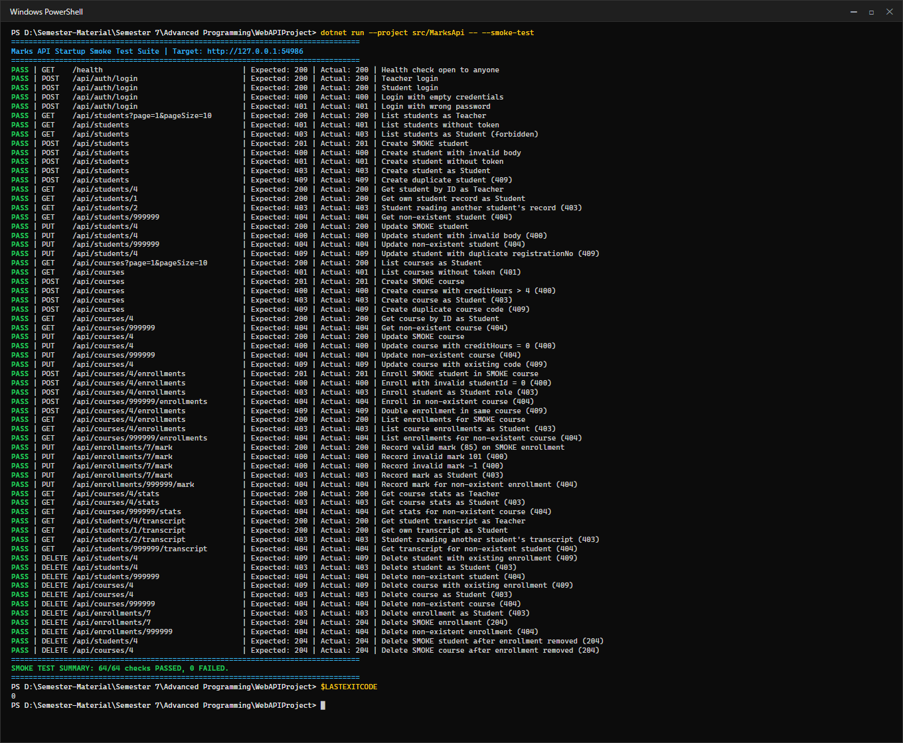
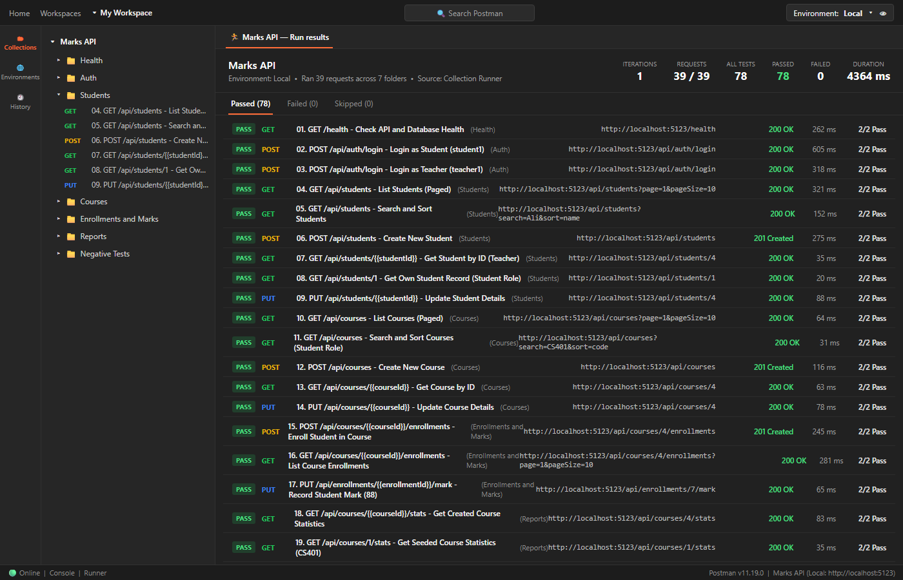
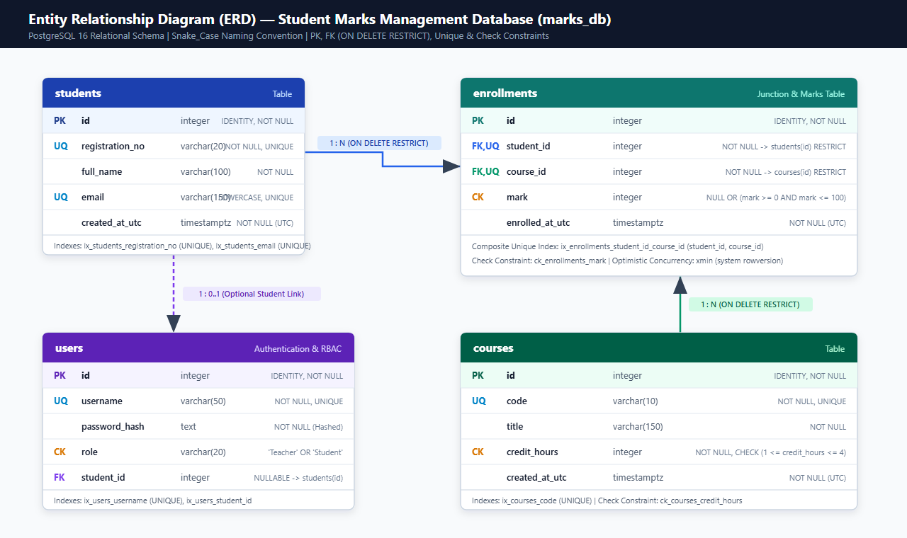

# Student Marks Management API (`MarksApi`)

**Course:** Advanced Programming (C# and .NET) — FAST NUCES, Chiniot-Faisalabad Campus  
**Repository:** [https://github.com/RazaSherazi09/ASPNetCore-StudentMarksAPI.git](https://github.com/RazaSherazi09/ASPNetCore-StudentMarksAPI.git)  
**Tech Stack:** C# 12, ASP.NET Core (.NET 8.0), Entity Framework Core 8.0, PostgreSQL 16/17, JWT Bearer Authentication, xUnit, Postman

---

## Table of Contents

1. [Project Description](#1-project-description)
2. [Pre-Installed OS Tools & Prerequisites Verification](#2-pre-installed-os-tools--prerequisites-verification)
3. [Repository Structure](#3-repository-structure)
4. [Step-by-Step Setup Guide (From a Clean Clone)](#4-step-by-step-setup-guide-from-a-clean-clone)
5. [Demo Usernames and Passwords (Development Only)](#5-demo-usernames-and-passwords-development-only)
6. [API Endpoints & Business Rules](#6-api-endpoints--business-rules)
7. [How to Run the Startup Smoke Test Module](#7-how-to-run-the-startup-smoke-test-module)
8. [How to Run the Postman Collection](#8-how-to-run-the-postman-collection)
9. [Bonus Features: xUnit Service Tests & Docker Compose](#9-bonus-features-xunit-service-tests--docker-compose)
10. [Database Design (ERD) & Key Design Decisions](#10-database-design-erd--key-design-decisions)

---

## 1. Project Description

The **Student Marks Management API** is a production-style RESTful web service built with ASP.NET Core and PostgreSQL for a university department.
- **Teachers** create and manage students and courses, enroll students into courses, record or update course marks (`0` to `100`), and view course-level statistics.
- **Students** browse the course catalog and securely view **only** their own student record and credit-hour weighted academic transcript.
- **Pass Mark Configuration:** The department pass mark (`50`) is read strictly from configuration (`Grading:PassMark`), never hardcoded in C#.
- **Standardized Errors:** Every `4xx` and `5xx` response uses RFC 7807 `ProblemDetails` (`application/problem+json`) with a global `IExceptionHandler` so unexpected errors return a clean `500` without leaking stack traces.

---

## 2. Pre-Installed OS Tools & Prerequisites Verification

All required tools and SDKs are already downloaded and configured on the Operating System (`PATH`). Before starting, you can verify each pre-installed tool from your terminal:

| Tool | Purpose | Verification Command | Installed Status on OS |
| :--- | :--- | :--- | :--- |
| **.NET 8 SDK** | Build, test, and run the API | `dotnet --version` | Installed (`8.0.428`) |
| **PostgreSQL (16 / 17)** | Relational database server & CLI | `psql --version` | Installed (`psql (PostgreSQL) 17.2`) |
| **EF Core CLI (`dotnet-ef`)** | Apply database migrations | `dotnet ef --version` | Installed (`8.0.34`) |
| **pgAdmin 4 / `psql` / `pg_dump`** | Inspect tables, data, and schema | `pg_dump --version` | Installed (`pg_dump (PostgreSQL) 17.2`) |
| **Git** | Version control | `git --version` | Installed (`2.52.0`) |
| **Postman** | Run automated API collection | Open Postman Desktop / Web | Installed & Ready |
| **Docker (Optional)** | Containerized PostgreSQL & API | `docker --version` | Installed (`29.8.2`) |

---

## 3. Repository Structure

```text
ASPNetCore-StudentMarksAPI/
├── src/MarksApi/                  # Main ASP.NET Core Web API project (.NET 8)
│   ├── Common/                    # GlobalExceptionHandler, ApiProblemException, DbExceptionHelper
│   ├── Controllers/               # AuthController, StudentsController, CoursesController, EnrollmentsController
│   ├── Data/                      # AppDbContext, DbSeeder, Entities/
│   ├── Dtos/                      # Request/Response DTOs and PagedResultDto
│   ├── Migrations/                # Committed EF Core Migrations (InitialCreate)
│   ├── Services/                  # Service interfaces and implementations
│   ├── SmokeTests/                # SmokeTestRunner (--smoke-test module)
│   ├── Dockerfile                 # Multi-stage Docker build for MarksApi
│   ├── Program.cs                 # DI registration, middleware pipeline, Auth, CORS, RateLimiting, Health
│   ├── appsettings.json           # Non-secret settings only (JWT issuer/audience, passMark 50, CORS)
│   └── appsettings.Example.json   # Example configuration with placeholder values
├── tests/MarksApi.Tests/          # Bonus: 12 automated xUnit tests for the service layer
├── postman/                       # MarksApi.postman_collection.json & Local.postman_environment.json
├── db/schema.sql                  # Exported schema (pg_dump --schema-only marks_db > db/schema.sql)
├── docs/                          # erd.png, report.pdf, screenshots/
├── appsettings.Example.json       # Root copy of example configuration with fake values
├── docker-compose.yml             # Bonus: Starts PostgreSQL 17 and MarksApi together
├── MarksApi.sln                   # .NET Solution file (API + xUnit test project)
├── README.md                      # Complete setup and testing guide
└── .gitignore                     # Excludes bin/, obj/, .vs/, and secret files
```

---

## 4. Step-by-Step Setup Guide (From a Clean Clone)

Follow these steps in order from a clean clone of the repository. Every command is self-contained and works directly without manual code edits.

### Step 1. Clone the Repository

Open a terminal (PowerShell or Bash) in an empty folder and run:

```bash
git clone https://github.com/RazaSherazi09/ASPNetCore-StudentMarksAPI.git
cd ASPNetCore-StudentMarksAPI
```

### Step 2. Create the PostgreSQL Database and Database User

Connect to your local PostgreSQL server as the `postgres` administrator and create `marks_user` and `marks_db` (the application connects strictly as `marks_user`, never `postgres`):

```sql
psql -U postgres
CREATE USER marks_user WITH PASSWORD 'MarksStrongPass2026!';
CREATE DATABASE marks_db OWNER marks_user;
\q
```

*(Alternative if you prefer running PostgreSQL in Docker)*:
```bash
docker run -d --name marks-postgres -e POSTGRES_USER=marks_user -e POSTGRES_PASSWORD=MarksStrongPass2026! -e POSTGRES_DB=marks_db -p 5432:5432 postgres:17
```

### Step 3. Configure User Secrets (No Secrets in Source Code or Git)

All sensitive values (database connection string, JWT signing key, and smoke-test login credentials) are stored outside the repository using `.NET user-secrets`. Run these commands from the repository root:

```bash
dotnet user-secrets set "ConnectionStrings:Database" "Host=localhost;Port=5432;Database=marks_db;Username=marks_user;Password=MarksStrongPass2026!" --project src/MarksApi
dotnet user-secrets set "Jwt:Key" "MarksApi-Super-Secret-Signing-Key-2026-Fast-Nuces-32CharsMin!" --project src/MarksApi
dotnet user-secrets set "SmokeTest:TeacherUsername" "teacher1" --project src/MarksApi
dotnet user-secrets set "SmokeTest:TeacherPassword" "Teacher@123" --project src/MarksApi
dotnet user-secrets set "SmokeTest:StudentUsername" "student1" --project src/MarksApi
dotnet user-secrets set "SmokeTest:StudentPassword" "Student@123" --project src/MarksApi
```

*(Note: On a production server, these same settings can be supplied via environment variables using double underscores, e.g., `ConnectionStrings__Database` and `Jwt__Key`. See [`appsettings.Example.json`](appsettings.Example.json) for a full template with fake values.)*

### Step 4. Build and Apply EF Core Migrations

Build the solution and apply the committed EF Core migration (`InitialCreate`) to create the four tables (`students`, `courses`, `enrollments`, `users`), constraints, indexes, and initial seed data in `marks_db`:

```bash
dotnet build
dotnet ef database update --project src/MarksApi
```

### Step 5. Run the API

Start the web API:

```bash
dotnet run --project src/MarksApi
```

The API listens on **`http://localhost:5123`** (configured in `src/MarksApi/Properties/launchSettings.json`):
- **Health Check Endpoint:** `GET http://localhost:5123/health`
- **Interactive OpenAPI / Swagger UI:** `http://localhost:5123/swagger`

---

## 5. Demo Usernames and Passwords (Development Only)

> **Important Security Note:** The following demo credentials are for **development and grading only**. Passwords are never stored in plain text in the database; they are stored strictly as PBKDF2-HMAC-SHA512 hashes generated via ASP.NET Core `PasswordHasher<User>`.

| Username | Password (Development Only) | Role | Linked Student Record | Capabilities |
| :--- | :--- | :--- | :--- | :--- |
| `teacher1` | `Teacher@123` | `Teacher` | `null` | Full access to create/update/delete students, courses, enrollments, marks, and view course stats & transcripts |
| `student1` | `Student@123` | `Student` | `id = 1` (`CS-2022-001`, Ali Raza) | Can list/view courses and read **only** Student #1's profile and transcript |
| `student2` | `Student@123` | `Student` | `id = 2` (`CS-2022-002`, Sara Khan) | Can list/view courses and read **only** Student #2's profile and transcript |

**Seeded Database Records:**
- **3 Students:** `CS-2022-001` (Ali Raza), `CS-2022-002` (Sara Khan), `CS-2022-003` (Usman Tariq)
- **3 Courses:** `CS401` (Advanced Programming, 3 Cr), `MA201` (Linear Algebra and Probability, 2 Cr), `AI302` (Machine Learning Fundamentals, 4 Cr)
- **6 Enrollments:** Including graded and ungraded (`mark = null`) enrollments so `/api/courses/1/stats` and `/api/students/1/transcript` can be tested immediately.

---

## 6. API Endpoints & Business Rules

All endpoints accept and return camelCase JSON, format timestamps as ISO 8601 UTC (`timestamptz`), and return RFC 7807 `ProblemDetails` on any `4xx` or `5xx` error.

| Method | Path | Who May Call | Success | Error Codes |
| :--- | :--- | :--- | :--- | :--- |
| `POST` | `/api/auth/login` | Anyone | `200 OK` | `400, 401, 429` |
| `GET` | `/api/students` | Teacher | `200 OK` | `401, 403` |
| `GET` | `/api/students/{id}` | Teacher, or own Student | `200 OK` | `401, 403, 404` |
| `POST` | `/api/students` | Teacher | `201 Created` | `400, 401, 403, 409` |
| `PUT` | `/api/students/{id}` | Teacher | `200 OK` | `400, 401, 403, 404, 409` |
| `DELETE` | `/api/students/{id}` | Teacher | `204 No Content` | `401, 403, 404, 409` |
| `GET` | `/api/courses` | Teacher, Student | `200 OK` | `401` |
| `GET` | `/api/courses/{id}` | Teacher, Student | `200 OK` | `401, 404` |
| `POST` | `/api/courses` | Teacher | `201 Created` | `400, 401, 403, 409` |
| `PUT` | `/api/courses/{id}` | Teacher | `200 OK` | `400, 401, 403, 404, 409` |
| `DELETE` | `/api/courses/{id}` | Teacher | `204 No Content` | `401, 403, 404, 409` |
| `POST` | `/api/courses/{courseId}/enrollments` | Teacher | `201 Created` | `400, 401, 403, 404, 409` |
| `GET` | `/api/courses/{courseId}/enrollments` | Teacher | `200 OK` | `401, 403, 404` |
| `PUT` | `/api/enrollments/{id}/mark` | Teacher | `200 OK` | `400, 401, 403, 404, 409` |
| `DELETE` | `/api/enrollments/{id}` | Teacher | `204 No Content` | `401, 403, 404` |
| `GET` | `/api/courses/{courseId}/stats` | Teacher | `200 OK` | `401, 403, 404` |
| `GET` | `/api/students/{id}/transcript` | Teacher, or own Student | `200 OK` | `401, 403, 404` |
| `GET` | `/health` | Anyone | `200 OK` | `503` |

---

## 7. How to Run the Startup Smoke Test Module

The startup smoke test module ([`src/MarksApi/SmokeTests/SmokeTestRunner.cs`](src/MarksApi/SmokeTests/SmokeTestRunner.cs)) runs **only** when explicitly requested via `--smoke-test` (or `SMOKE_TEST=true`). It sends **64 real HTTP requests** covering every endpoint (both valid and failing requests: `200, 201, 204, 400, 401, 403, 404, 409`) against the live PostgreSQL database, deletes all `SMOKE-` test data upon completion, and exits with code `0`.

Run the smoke test from the repository root with this exact command:

```bash
dotnet run --project src/MarksApi -- --smoke-test
```



---

## 8. How to Run the Postman Collection

1. Start the API (`dotnet run --project src/MarksApi`).
2. Open **Postman** and click **Import**:
   - Select [`postman/MarksApi.postman_collection.json`](postman/MarksApi.postman_collection.json)
   - Select [`postman/Local.postman_environment.json`](postman/Local.postman_environment.json)
3. Set the active environment dropdown (top-right in Postman) to **`Local`** (`baseUrl` is `http://localhost:5123` and `token` is initially empty).
4. Open **Collection Runner** on the **`Marks API`** collection and click **Run Marks API**:
   - All **39 requests** (78 assertions) across the 7 folders (`Health`, `Auth`, `Students`, `Courses`, `Enrollments and Marks`, `Reports`, and `Negative Tests`) run in order and pass automatically.
   - Login requests save `{{studentToken}}` and `{{token}}` automatically.
   - Create requests chain `{{studentId}}`, `{{courseId}}`, and `{{enrollmentId}}` to subsequent requests and clean up the created resources at the end of the run (`37`–`39`).



---

## 9. Bonus Features: xUnit Service Tests & Docker Compose

### Run the 12 Automated xUnit Service-Layer Tests

```bash
dotnet test tests/MarksApi.Tests/MarksApi.Tests.csproj
```

### Run API + PostgreSQL Together with Docker Compose

```bash
DB_PASSWORD="MarksStrongPass2026!" JWT_KEY="MarksApi-Super-Secret-Signing-Key-2026-Fast-Nuces-32CharsMin!" SMOKE_TEACHER_PASSWORD="Teacher@123" SMOKE_STUDENT_PASSWORD="Student@123" docker compose up --build
```

---

## 10. Database Design (ERD) & Key Design Decisions



1. **Why `409 Conflict` (and not `400 Bad Request`) for Duplicates & Delete Restrictions:**  
   `400 Bad Request` indicates invalid request syntax or field validation failures (e.g., an empty student name or a mark of `101`). Submitting a well-formed student registration number that already exists, enrolling a student in the same course twice, or deleting a student/course that still has enrollments conflicts with the **current state of the resource** on the server. Returning `409 Conflict` adheres to HTTP RFC 9110 §15.5.10.
2. **Concurrency Safety via Unique Indexes & `DbUpdateException` (No Check-Then-Insert):**  
   Checking whether a record exists before inserting creates a Time-of-Check to Time-of-Use (TOCTOU) race condition when two concurrent requests arrive at the same millisecond. Instead, the services execute the `INSERT` / `UPDATE` / `DELETE` directly and catch `DbUpdateException`, inspecting `PostgresException.SqlState` (`23505` for unique violations and `23503` for foreign-key delete restrictions) to return a clean `409 Conflict` `ProblemDetails` response.
3. **Optimistic Concurrency on Mark Updates (`xmin`):**  
   `Enrollment.Version` is mapped to PostgreSQL's `xmin` system transaction column via `.IsRowVersion()`. If two teachers load the same enrollment concurrently and attempt to save different marks, EF Core detects the stale `xmin` version, throws `DbUpdateConcurrencyException`, and returns `409 Conflict` rather than silently overwriting the first teacher's mark.
4. **Read-Only Projections (`AsNoTracking` + `Select`):**  
   Every `GET` query uses `.AsNoTracking()` and projects directly into response DTOs in SQL, avoiding entity change-tracking overhead and never exposing EF Core entities outside the service layer.
